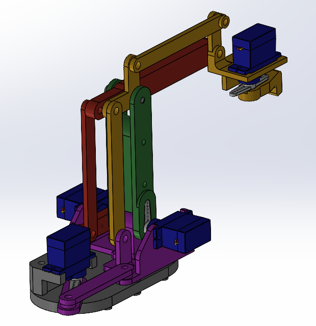

## Overview

A low-cost, four-degree-of-freedom arm I designed, 3D printed, wired and programmed myself, as a platform for mechanical design, embedded control and robot kinematics. It runs on MG90S servos and an Arduino Uno, moves to Cartesian targets with inverse kinematics, and has a real-time MATLAB 3D model for checking its motion.

The arm works, and the most useful lesson came from where it fell short: the IK math was right, but positioning accuracy was limited by the physical build.

## Design

The arm uses a double-parallelogram linkage, which keeps the end effector at a fixed orientation everywhere in its workspace. The mechanism does part of the control work: the gripper stays level without a wrist joint having to correct for it.

## Build problems

- **Binding joints.** Printed holes came out undersized, so the fasteners interfered and the linkage bound up, which the low-torque servos couldn't overcome. I adjusted hole diameters, reprinted parts and greased the joints with silicone grease.
- **Powering several servos.** The Arduino can't supply several servos moving at once. I added an external power adapter through a barrel jack, with crimped Dupont connectors wiring the supply and servo leads to the breadboard.
- **Servos at the end of their travel.** Several servos had been mounted near their rotation limits, which cut the usable joint range. I repositioned and reinstalled them so the commanded range matched the joints' actual range.

## Control

I started with joint-level control, using rotary encoders to position each joint by hand and confirm the arm's range of motion. Next came two-joint inverse kinematics (with the Kinematics library), so I could command an end-effector position instead of individual joint angles.

To see what the IK was actually doing, I built a real-time 3D simulation in MATLAB (video above). It shows the arm's configuration as the IK solution changes, so I could check commanded joint motion and end-effector paths separately from the hardware, and spot where the model and the real arm disagreed.

## What I learned

The IK generated the right joint commands, but the arm didn't land exactly where the math said it should. Friction, binding, limited encoder input precision and differences between the ideal kinematic model and the printed assembly all added error.

The biggest problems showed up where subsystems met: print tolerances, friction, servo calibration and power delivery all affected control performance. A robot is only as accurate as the physical system carrying out its commands, not just its algorithms.

## Next steps

Tighter joint tolerances or bearings to remove binding, and joint-angle feedback so the kinematic model can be calibrated against the real arm.
