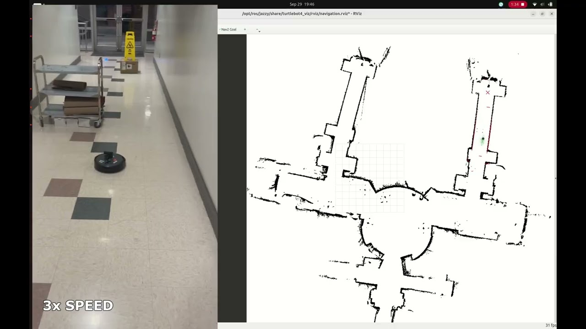
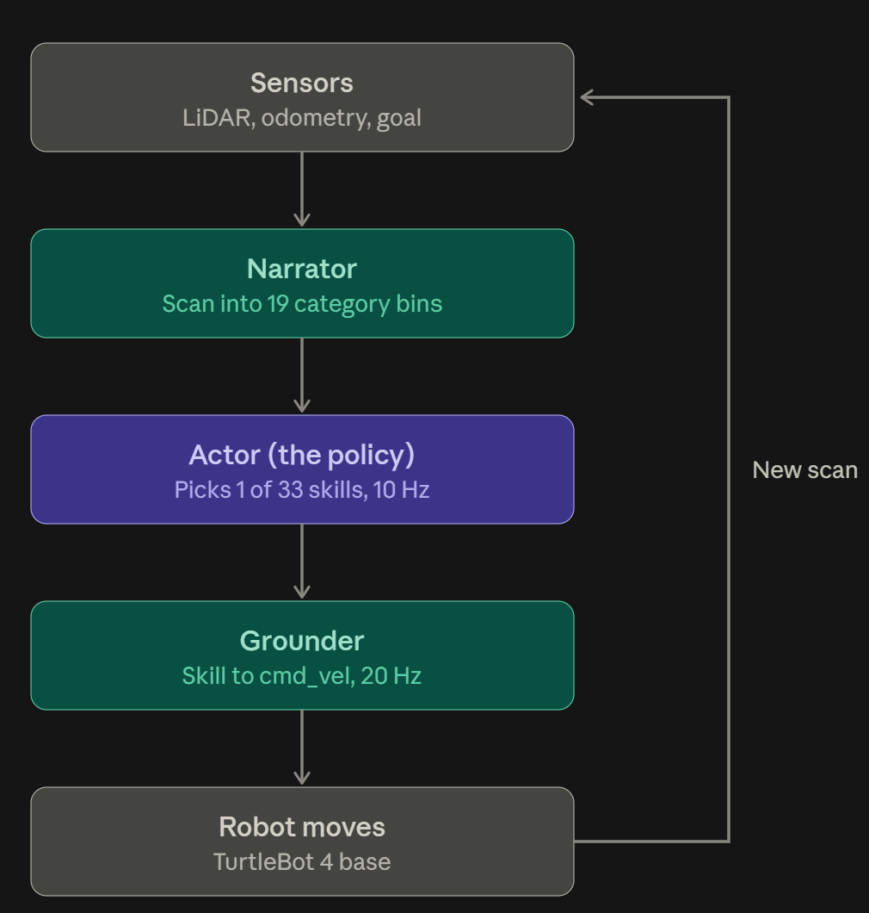

## Overview

Navigation policies are usually tied to the robot they were trained on. Change the footprint, top speed or drive type and you retrain. This project tests whether **one set of weights can drive many bodies**, without being told which body it has.

The result is a 2.5M-parameter recurrent policy that picks one of 33 discrete skills (stop, move toward one of 16 sectors, rotate to face one) every 0.1 s. It never sees robot size, speed, drive type or metric pose. I deployed it on a real TurtleBot 4 under ROS 2 Humble.

## How it works

Robot-specific logic sits outside the learned model, on either side of it.

| Layer | Learned | Job |
|---|---|---|
| Narrator | No | Turns LiDAR or depth, odometry and the goal into 16 obstacle bins and a goal reference. Distances are measured from the robot's inflated footprint, so a big robot and a small one see the same "near". |
| Actor | Yes | Picks a skill from that categorical context plus its previous skill. A Transformer or LSTM core with a Kalman-style belief update gives it memory, and missing data never counts as evidence. |
| Grounder | No | Converts the skill to `cmd_vel` at 20 Hz for the specific drive type and speed limits. |

**Training.** PPO in a batched 2D simulator with 12 procedural map families. Every episode randomised robot radius (0.1 to 0.9 m), speed, clearance margin, sensor (surround LiDAR or 110° front camera) and drive type (differential, reversing, omnidirectional, car-like). None of it was given to the actor. On top of PPO I added a privileged critic, a decaying imitation term from a geodesic expert, and world-model losses that predict hidden context and future states up to 6.4 s ahead.

**Deployment.** Inference is argmax only, about 3.4 ms on one CPU thread. Safety is entirely outside the model: freshness timeouts, a watchdog, an inference deadline and an emergency-stop topic. Camera input goes through Depth-Anything-V2 metric depth and a geometry check that only marks a sector clear if its whole collision band is visible. In the demo, I click goals in RViz and the policy drives to each one without Nav2.

## Results

Chosen from 50 checkpoints across 25 runs. On 36 fresh simulation episodes it reached the goal in **30 (83%)**, with 5 collisions and 1 timeout.

| Slice | Success |
|---|---|
| Differential drive | 18 of 18 |
| Surround LiDAR | 24 of 26 |
| Omnidirectional | 6 of 9 |
| Car-like | 6 of 9 |
| Front camera only | 6 of 10 |

The exported models match their training code exactly over 160-step parity tests. These numbers are from simulation. The hardware demo is qualitative, with no quantitative evaluation on the robot yet.
