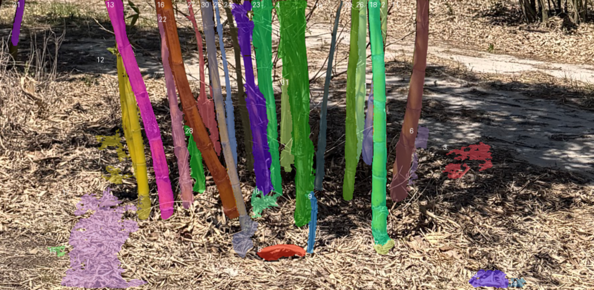

## Overview

Automated bamboo harvesting depends on perception: picking out and segmenting individual culms in a very dense stand. Field time is limited, so I built a Gazebo sim that generates repeatable test data. A Clearpath Husky drives up to a culm, orbits it at a fixed radius, and records RGB-D, lidar and odometry to a ROS bag. The bags are then used to benchmark the perception pipeline.



This is the target: segmentation on a real stand. The sim supplies the ground-truthed data to test it against.

## How it got built

Each stage matches one of the videos above, oldest last.

1. **One culm.** A single cylinder in an empty world. The robot finds it with 2D lidar, drives to it, orbits it once and stops.
2. **Several culms, pick one.** You click a culm in RViz (Publish Point). The robot clusters the lidar returns near the click and fits a circle to them, and it checks the click against the scan before it moves.
3. **A real culm.** The lab's 5.3M-point scan had no faces or normals, and it turned out to be a backdrop board with seven bamboo sticks, not one culm. I used Open3D to convert it into Gazebo geometry. RANSAC removes the board, DBSCAN splits out the 7 sticks, each stick gets a Poisson mesh (about 51k triangles in total), and fitted cylinders serve as the collision shapes. The robot carries two RealSense D435s, one facing forward and one facing left, and a 2D lidar.

## How it works

**State machine.** `IDLE` (check the click against the lidar) → `APPROACH` → `ALIGN` (turn side-on, start recording) → `ORBIT` → `DONE`, with a `LOST` state and a safety stop.

**Detection.** The circle fit from stage 2 breaks on the real bundle. From 2 m the lidar sees 3–6 partial arcs, and the thinnest stick gets about one beam. Instead, the detector registers the bundle's known seven-circle footprint to the scan. It uses Gauss-Newton with a Huber loss and weak priors, so one or two visible sticks are enough. Fixes with too few inliers, a high residual, or a jump over 25 cm are rejected.

**Control.** A guiding-vector-field orbit law in which heading error decays exponentially and the radius converges:

```python
e = r - R
beta_d = s * (pi/2 - atan(k_r * e))     # desired bearing to the center
delta = wrap(beta - beta_d)
v_cmd = v * max(0.3, cos(delta))
w = (v_cmd / r) * sin(beta) - beta_d_dot + k_beta * delta
```

**Recording.** Bags are MCAP with zstd compression and hold both RGB-D streams, odometry, TF, the scan and the controller's debug topics. Each bag covers the whole lap and ends exactly at `DONE`.

## Problems I had to solve

- **Laps stopped at 336°.** Skid-steer odometry under-counts yaw by about 7% per lap, so the odom frame itself rotates. I measure the swept angle in the culm's own frame, which cancels the drift: 335.7° → 357.0° → 360.2°.
- **Registration found the wrong minimum.** A single starting guess failed in 14 of 24 test cases. A coarse multi-start grid search for the first fix solved it.
- **Cameras.** The ZED 2i ran the sim at 0.1× real time. The Blackfly has no rate limit, so it rendered at the physics rate (about 300 Hz). The RealSense D435 holds 1.0× real time. Its optical frames were missing from Clearpath's model, so my launch file publishes them.
- **The recorder missed the start of the lap.** `ros2 bag record` takes about 3 s to start. Recording now starts during `ALIGN`, and `ORBIT` waits until every topic is subscribed.
- **Reset broke silently.** rclpy's static broadcaster ignores updates to a frame it has already sent, so after a teleport the next click landed in the wrong place. I replaced it with my own latched publisher.
- **Upstream gaps.** Clearpath has no headless mode, and one release skipped the controller spawner in sim. A wrapper launch handles both without modifying any installed package. The EKF hung on startup about 1 launch in 14; spawning the robot only after the first `/clock` message mitigated it.

## Results

Three laps at R = 2.0 m and 0.25 m/s, scored against Gazebo ground truth (used for evaluation only, never by the controller):

| Lap | RMS after 5 s settling | Whole-lap RMS | Swept angle |
|---|---|---|---|
| 1 | **6.5 mm** | 12.1 mm | 360.0° |
| 2 (after reset) | 8.3 mm | 19.2 mm | 360.1° |
| 3 | **6.5 mm** | 11.7 mm | 360.0° |

The target was under 50 mm. Each lap takes about 52.6 s. A typical bag is 56 s long with 36,790 messages (about 41 MiB), with the cameras at 10 Hz and the lidar at 40 Hz. The code has 43 unit tests and a cold-start end-to-end test.

All results are from simulation. The detector needs the bundle's footprint in advance, and the mesh has no colour or texture.

## Next steps

Run the segmentation pipeline on these bags, estimate a culm's footprint during the approach instead of loading it from a file, and move the stack to the real Husky.
