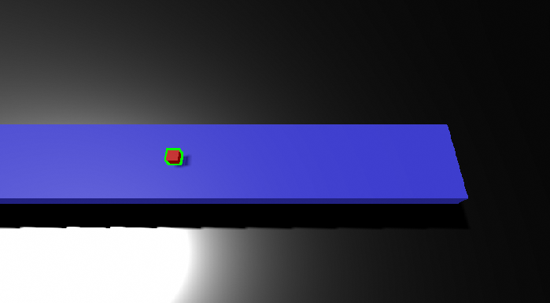

## Overview

A cube rides a conveyor toward a Franka FR3 arm. The only camera watches the first 1.3 m of the belt, so the cube travels at least 2.75 m unseen (9–30 s, depending on speed) before it reaches the robot. The system has to predict where the cube will be, decide whether that prediction is good enough to act on, and grasp the cube while it is still moving.

At 0.3 m/s the MPC controller intercepted the cube in **4/4** runs, while the strongest hand-tuned Jacobian controller managed **0/4** on the same observations. The MPC also stayed under the real FR3's 10 rad/s² joint-acceleration limit, which the baseline exceeded by 2.5×.

## How it got built

Each stage added one capability and exposed the problem the next stage had to solve.

| Stage | What it added | Key result |
|---|---|---|
| 1. Stationary pick and place | Overhead RGB-D camera, OpenCV cube pose, a nine-stage MoveIt 2 plan executed through ros2_control | Pose error 1.9 mm; cube placed 3.2 mm from the goal |
| 2. Moving belt | A C++ Gazebo plugin that pushes the cube with a PI-controlled force, since Bullet physics can't move objects with a belt surface. A Jacobian velocity loop follows the cube | Following error ≤ 2.1 mm using simulator ground truth |
| 3. Camera in the loop | Ground truth replaced with live OpenCV poses, plus stale-data and camera-loss stops | Pose error ≤ 3.5 mm |
| 4. Kalman filter | Calibrated filter that keeps the estimate current between frames | Controller input within 0.4–1.2 mm of truth |
| 5. Dynamic grasp | A grasp state machine with gates measured against ground truth, plus feedforward | 100% pick and place up to 0.3 m/s |
| 6. Upstream camera + MPC | Blind-transit prediction, accept/reject logic, kinematic MPC | The table below |

## How it works

**Perception.** HSV segmentation of the red cube, back-projection of the depth pixels, transformation into the world frame, then a rectangle fit to the top face for the cube's center and yaw. Detections past the end of the camera window are discarded, so the robot is guaranteed to get no measurements during the transit.

**Estimation.** A Kalman filter rejects outliers and corrects for the camera's bias. A separate constant-velocity least-squares fit carries the cube through the blind transit and reports a 1σ uncertainty. The cube is accepted only if σ at the end of the grasp is 17 mm or less. The robot then picks the earliest entry point it can reach in time. Otherwise the cube is rejected, since σ only grows the longer it waits.

**Control.** A linear time-varying kinematic MPC over the 7 joint velocities:
- 20 × 20 ms horizon, a 140-variable QP, re-solved at 25 Hz with OSQP on Pinocchio Jacobians.
- Costs on TCP position, gripper orientation and velocity matching with the belt.
- Hard limits on joint speed, acceleration and position, plus floors that keep the hand and forearm above the belt.
- If a solve fails, the robot reuses the previous plan, shifted; after three failures it stops.

**Grasping.** A pure-Python state machine (gate → descend → close → lift). It closes only when the gripper is aligned with the cube within the measured gates (22 mm along the belt, 4 mm across, 10 mm/s relative speed). MoveIt then carries the cube to the goal. A native ros2_control velocity controller with a 200 ms command watchdog stops the arm if the commands stop arriving.

The grasp gates came from deliberately offsetting the gripper and recording where grasps succeed (left). Each controller change then pushed the speed limit further (right). These runs are stage 5, before the upstream camera and MPC.

## Hard problems

- **A perfect camera made a meaningless filter.** The simulated camera had no noise, and its bias (1–2.5 mm, varying along the belt) was larger than the noise once I added some. Fitting a position-dependent bias correction brought NEES down from the thousands.
- **No single process noise works.** Measured process noise differs by six orders of magnitude between steady belt motion and belt starts and stops. An adaptive Q driven by NIS cut the error during transients from 24–27 mm to 5–7 mm.
- **The tracking filter can't predict 30 s ahead.** Propagated blind, the live filter's σ grew to about 300 mm, so every cube would have been rejected. A separate batch fit with measured uncertainty floors (2 mm of camera bias, 0.4% belt-speed drift) gave a σ that was honest: all 24 final runs landed within 1σ.
- **The arm stalled halfway down.** Logging joint effort and forward kinematics showed the forearm hitting the belt edge on the low-elbow IK solution. Seeding IK with an elbow-up posture across the whole grasp window fixed it.
- **The MPC was too slow at first** (19 ms median, 35 ms p95, with timeouts). Vectorised QP assembly, row scaling and warm starts that reuse the previous solution brought it to 3 ms / 7 ms.

## Results

Four runs per cell, scored against Gazebo ground truth (the controllers never see it). Both controllers get the same prediction, entry point and grasp gates; only the control law differs.

| Belt speed | MPC pick and place | Jacobian baseline |
|---|---|---|
| 0.1 m/s | 4/4 | 4/4 |
| 0.2 m/s | 4/4 | 4/4 |
| 0.3 m/s | **3/4** (4/4 grasped) | **0/4** |

At 0.3 m/s the baseline grasped too slowly and ran out of reach before the lift finished. The one MPC miss was a later carry-to-goal step, after a successful grasp.

| Metric | MPC | Baseline |
|---|---|---|
| Peak joint acceleration (FR3 limit 10 rad/s²) | **9.6 rad/s²** | 25 rad/s² |
| Solve time, median / p95 | 3.1 / 7.2 ms, 0 failures | n/a |
| Arrival-prediction error | within 1σ in all 24 runs (σ ≈ 13–15 mm) | same predictor |

I also raised the belt speed 10% while the cube was out of the camera's view. Neither controller could recover: the cube arrived 25–29 cm away from where it was predicted. With no measurements during the blind stretch, a single upstream camera can't correct for that. All results are from simulation.

## What I learned

- **Verify the physical outcome, not the command.** Early on the belt reported a speed while the box sat still. From then on, every test checked measured motion or final position.
- **Make uncertainty honest before trusting it.** Calibrating the filter's noise against ground truth, and adding the uncertainty floors, turned σ into something the robot could safely base an accept/reject decision on.
- **Compare against the strongest baseline on identical inputs.** Both controllers were limited by the same prediction error, so the MPC's real advantage wasn't accuracy. It finished the grasp in time and stayed within the hardware's acceleration limits.
- **Test the failure modes on purpose.** Killing the camera, killing the command publisher and stopping mid-motion all became tests. The disturbance runs also exposed a bug: the grasp check reported "holding" when the gripper had closed on nothing.

## Next steps

Add a second camera near the robot or a camera on the hand to correct the prediction during transit, fix the empty-grasp check, make gripper orientation a strict priority in the MPC, and recalibrate on a real camera before trying hardware.
