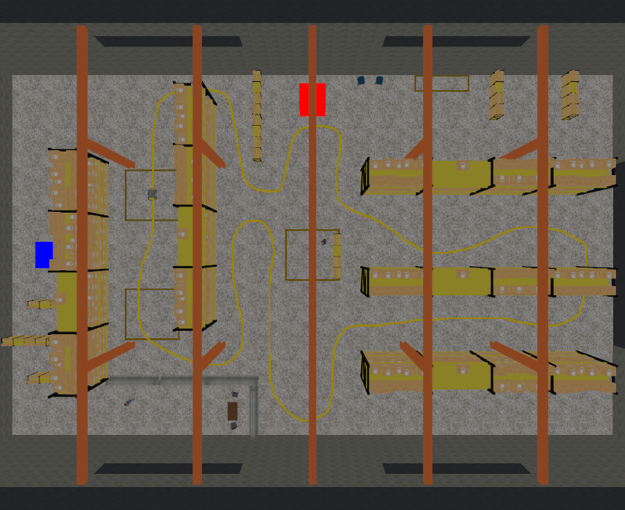
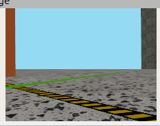

## Overview

My [cross-embodiment navigation policy](/projects/cross-embodiment-navigation) needed a benchmark of navigation tasks beyond reaching a point goal. Line following was the first. I built the environment in ROS 2 Jazzy and Gazebo Harmonic: a 158.6 m loop painted on the floor of a warehouse.

The same OpenCV follower drives two very different bodies, a wheeled Clearpath Husky and a legged Unitree Go1. That gives the learned policy a classical baseline on two morphologies.

## How it works

**Track.** I hand-drew the loop at 1:1 scale with the floor. A script skeletonizes the drawing (Zhang-Suen) and re-dilates it to a 15 cm line. From that one source it produces the floor decal, the mesh and a 4,979-point ground-truth centreline, so the scorer measures against the line that is actually painted.

**Perception.** HSV threshold → 5×5 morphological close → largest contour (at least 300 px) → the centroid's offset from the image centre, scaled to −1…+1. The region of interest is rows 55–85% of the frame. Cutting the top drops shelving and hazard tape in the far field. Cutting the bottom keeps the line in view when the robot steps sideways.

**Control.** Steering is `ω = −1.5 · error`, clamped to 1.2 rad/s. Speed is `v = 0.6 · (1 − 0.6·|error|)` m/s, so the robot slows in turns. Sensor callbacks only record data, and a fixed 20 Hz timer sends the commands. When the camera stalls, the follower treats it as a lost line instead of repeating the last command.

| Robot | Camera | What I changed |
|---|---|---|
| Husky | RealSense moved to the sensor arch, 0.30 m forward and pitched 25.8° down, set in the Clearpath `robot.yaml` that generates the URDF | The default mount rendered the image upside down, and the bumper hid the near field |
| Go1 | Stock forward camera, 640×480 at about 9 Hz | Fixed the camera optical frame in the xacro. The trot bobs the camera, so the line shifts in the image |

**Scoring.** A harness launches the whole stack and reads ground-truth pose straight from Gazebo, because the Husky's skid-steer odometry drifts about 1 m per lap. It returns PASS/FAIL on cross-track error and loop coverage.

## Problems I had to solve

- **Camera jitter.** The sim camera ran at 19.6 Hz instead of 30, with gaps up to 363 ms. A 0.3 s timeout kept declaring the line lost while it was in view. I set the timeout to 0.7 s, from the worst-case gap rather than the nominal rate.
- **Yellow everywhere.** I tested lidar bug0 avoidance around boxes on the track, and the follower kept locking onto the stock warehouse's own yellow props. I recoloured the line green and re-tuned the HSV bounds. I never finished the avoidance, because the project moved to Isaac Sim and Isaac Lab.

- **Backwards laps.** A stripe has no direction, so after a detour the robot could rejoin the line and follow it in reverse. An odometry check against the remembered direction of travel turns it around.
- **Losing the line in corners.** The robot coasts on its last command for 0.5 s, then rotates in place toward the side where it last saw the line, limited to ±100°.
- **Environment.** Conda's Python 3.14 shadowed Jazzy's 3.12 and broke the ROS imports in the Go1 gait scripts. Two releases of the Clearpath simulator spawn controllers differently, so I wrote a script that starts only the missing controllers.

## Results

Both robots complete the full loop (the videos show partial laps). The Husky's scored lap took 340 s:

| Metric | Value |
|---|---|
| Mean / median cross-track error | **0.060 m** / 0.042 m |
| 95th percentile / max | 0.160 m / 0.320 m |
| Samples within 15 cm | 93% |
| Loop coverage | 100% |

Error is about 4 cm on the straights and peaks in tight turns. There, the detected blob is curved, and its centroid sits inside the turn. Following a narrow scanline instead of the whole band would fix that better than raising the gain. All results are from simulation.
