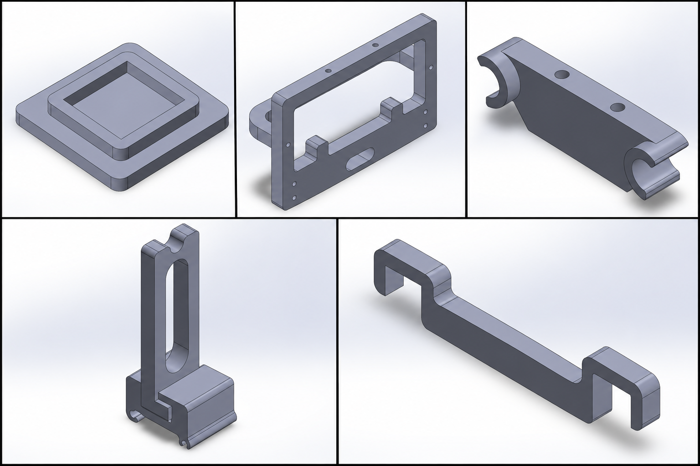
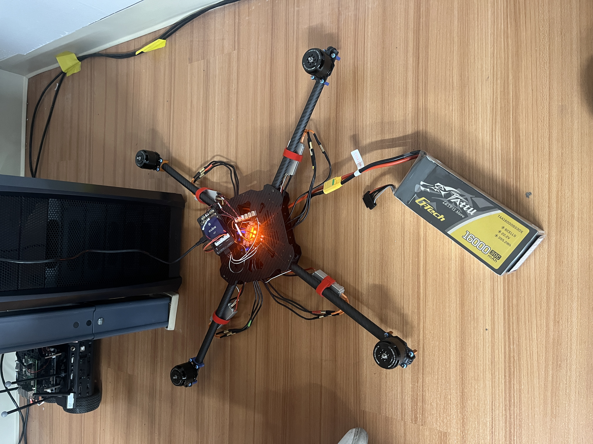

## Overview

The Nonlinear Controls and Robotics Lab needed a fleet of ten quadcopters as a research platform for autonomous navigation, perception and multi-robot work at UF's Autonomy Park. They fly both manually and autonomously. All ten share one modular hardware layout, which makes them easier to assemble, maintain and fit with new sensors.

I worked across the build: mechanical integration and custom 3D-printed mounts, propulsion and power wiring, flight-controller and companion-computer integration, and initial autonomous flight testing from ROS 2.

## Platform

| Component | Role |
|---|---|
| Carbon-fibre frame | Commercial airframe the fleet is built on |
| Cube flight controller running PX4 | Low-level flight control and stabilisation |
| Jetson Orin Nano | Onboard computer for autonomy software |
| 2D lidar, optical flow, RTK GPS, IMU, ZED stereo camera | Sensing for localisation and perception |
| QGroundControl | Configuration, monitoring and flight testing |

## Custom 3D-printed parts

The off-the-shelf frames weren't built for this much sensing and compute. I designed sensor mounts and electronics holders so that hardware that didn't fit the carbon-fibre frames could still be mounted securely. Space and payload were both tight, so where each component went, how it was mounted and how its cables were routed all had to be planned together.

## Electrical build

I assembled and wired the propulsion systems: soldering bullet connectors onto the brushless motors and ESCs, and soldering the ESC power leads to the power distribution board. Every joint had to survive vibration and repeated flights, but still come apart when the hardware changes. The board pads, for example, are soldered in a set counter-clockwise order so the iron can still reach the later pads.

A completed drone powering up on its LiPo pack for the first time.

## Flight control and autonomy

Each drone splits the work into two layers. PX4 on the Cube flight controller handles stabilisation, and the Jetson runs higher-level autonomy. We configured, monitored and flight-tested the PX4 side through QGroundControl. Each drone also has to be calibrated individually: loading another drone's parameter file brings in that drone's compass and IMU offsets, which causes drift and estimator faults.

We then used ROS 2 as the command path to PX4. The key milestone was an autonomous takeoff started from a ROS 2 node (video above): the software issued the command while PX4 flew the drone. That moved the fleet from manual teleoperation to programmatic flight, and it's the foundation for later autonomous navigation and multi-robot experiments.

## What I learned

This project took me through the whole process of building an aerial robot, from fabrication and power distribution to flight-controller setup and software-driven flight. The main lesson: reliable autonomy depends on every layer working together, including the frame, power, onboard computer, communication links and control software. A fault in any one layer can stop the drone from flying, however good the autonomy software is.
