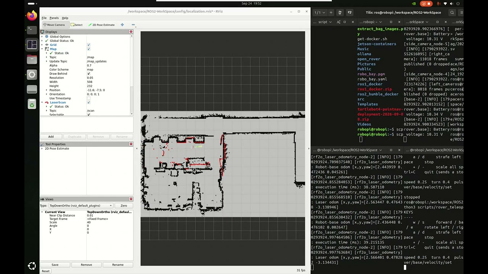
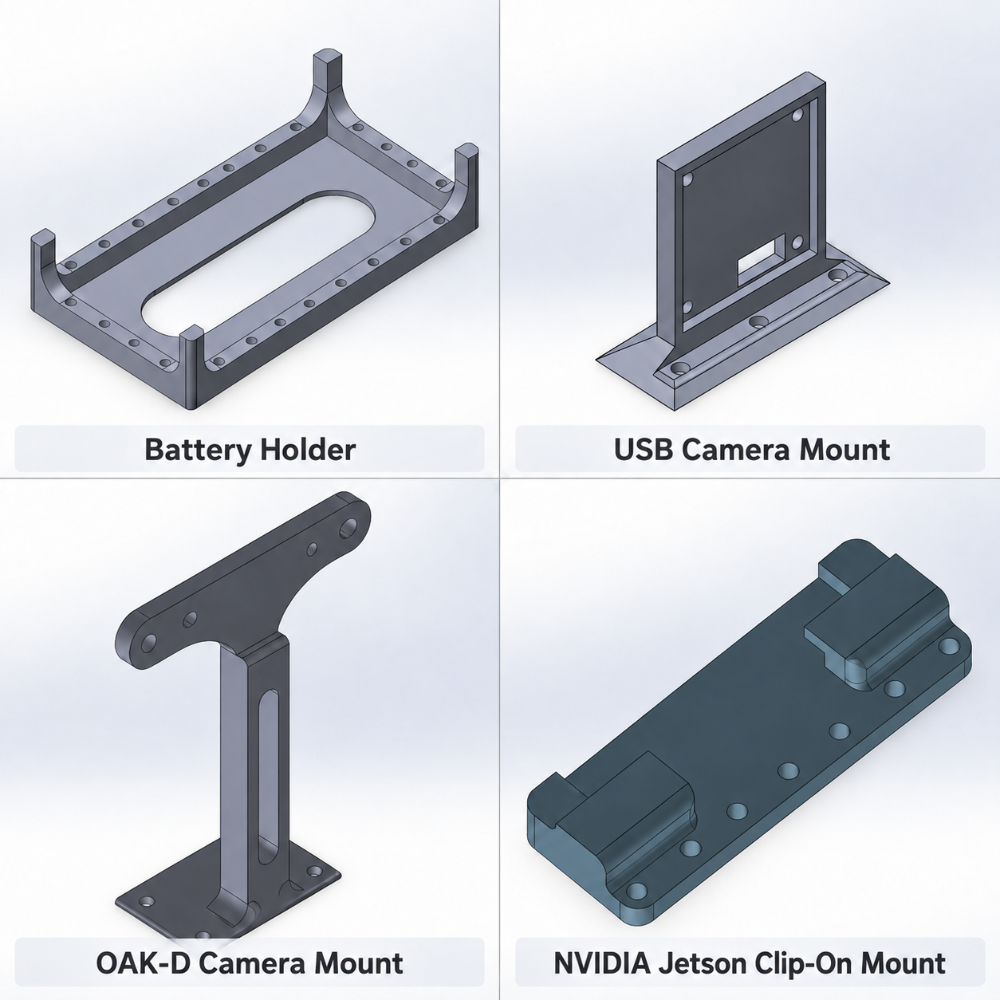
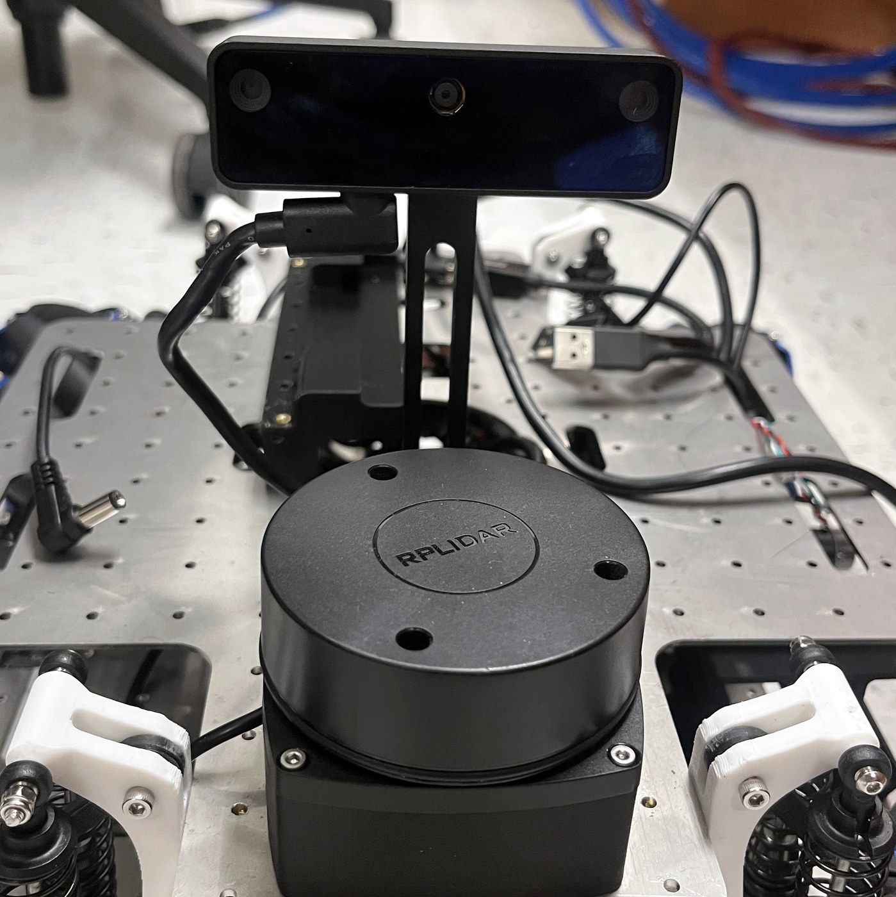
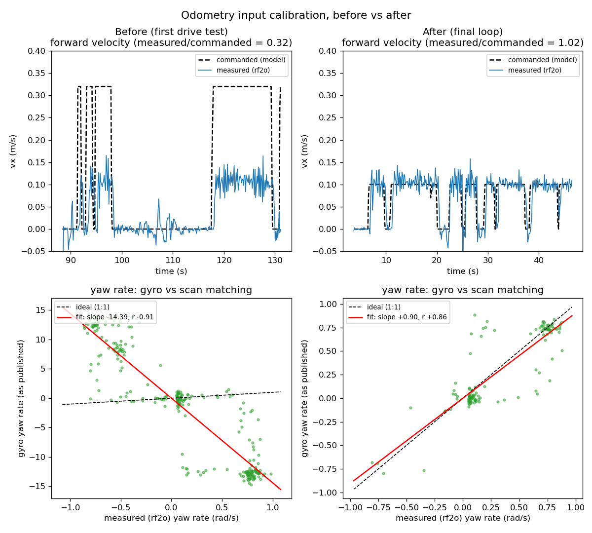

## Overview

The OpenRover is an omnidirectional lab robot with **no wheel encoders**. A drone flight controller drives its motors open-loop, so nothing measures how far it actually moved. Before this work, its fused odometry missed a hand-driven loop by 0.92 m, and in RViz the robot didn't turn when it physically turned.

I rebuilt the localization stack in ROS 2 Humble on a Jetson Orin. An extended Kalman filter fuses three imperfect motion sources, and AMCL corrects the result against a prebuilt lidar map. Most of the work was diagnosis: six separate faults were stacked on top of each other, and each one hid the others.

I also designed the CAD for the parts that hold the hardware on the rover: a battery holder, a USB camera mount, the OAK-D camera mount and a clip-on mount for the NVIDIA Jetson.

## How it works

Each sensor fails in a different way, so the EKF (`robot_localization`) fuses only the part of each one that can be trusted.

| Source | Fused as | Why |
|---|---|---|
| Lidar scan matching (rf2o, ~7 Hz) | x, y, yaw, as pose deltas | Measures real motion and isn't fooled by wheel slip, but slips along featureless corridors |
| Commanded velocity (~50 Hz) | vx, vy | Always available, so it carries the estimate through corridors. Reports near-zero variance when parked, acting as a zero-velocity update |
| Flight-controller gyro | yaw rate | Lets the filter predict a turn instead of discovering it scan by scan |

AMCL takes the fused odometry as its motion prior. It uses an omnidirectional motion model because the robot strafes, and 180 beams per scan instead of nav2's default 60.

**Finding the faults.** I wrote a passive drive-test analyzer that regresses each input against scan matching. A negative slope means a reversed input, and the slope gives the gain correction directly. I checked scan matching's own scale against a tape measure, and it was within 1% over 2.29 m. The faults it found:

- **Duplicate TF publishers.** Several launch files started their own lidar transform at different offsets, so the lidar appeared to jump 73 mm. I split the launch files so every driver and frame has exactly one owner, with all frames from one measured URDF.
- **Scan matching reversed.** An upstream rf2o bug falls back to an identity lidar pose if the first TF lookup fails. This lidar is mounted backward, so forward was reported as backward. I patched rf2o to wait for the transform.
- **Turns rejected.** With nothing predicting rotation, the EKF's outlier gate threw out every real turn. Replaying simulated turns through an isolated filter showed a 360° turn registering as about 4°. Removing the gate and fusing the gyro tracked it to 355°.
- **Gyro reversed and 16× too large.** The driver treated raw sensor counts as degrees per second, and the flight controller counts yaw clockwise. Regression slope: −14.4.
- **Velocity model 3× too optimistic.** At teleop throttle the motors sit near their deadband. I recalibrated the forward and strafe gains separately.
- **The robot's own arm in the scan.** About 4% of beams hit the arm, which pulled scan matching toward "no motion". A range filter removes them.

**Tuning the covariances.** The inputs were calibrated from data. The covariances were set from each sensor's failure mode, then checked against the drive logs.

| Input | Covariance | Reasoning |
|---|---|---|
| Commanded velocity | (slip × v)² + 0.01², with slip 0.30 forward and 0.50 strafe | Uncertainty grows with speed, strafe slips more than forward, and the variance collapses at rest into a zero-velocity update. The logs showed 28–37% forward error, close to the 30% chosen |
| Gyro yaw rate | σ = 0.03 rad/s | Covers the measured parked bias and a few percent of scale error |
| Scan matching pose | 1e-3 on x, y and yaw | rf2o ships an all-zero covariance, which an EKF reads as "known exactly". I patched in real values |
| Unmeasured axes | 1e6 | Marked as unknown instead of zero, so other consumers aren't misled |

**Tuning AMCL.** I changed each parameter from the nav2 default for a specific reason:

| Parameter | Default → mine | Why |
|---|---|---|
| Motion model | differential → omni | The robot strafes, so a differential model would treat every sideways move as noise |
| `alpha1–5` | 0.2 each → 0.08 / 0.08 / 0.10 / 0.08 / 0.10 | Odometry-noise sets for three sources: command only, scan matching only and fused. The fused set is tightest, but α3 stays above 0.05 so AMCL can still correct a slip along the corridor |
| `z_hit` / `z_rand` | 0.5 / 0.5 → 0.85 / 0.15 | The default treats half of every reading as noise, which matched the symptom of slow lock-on followed by drift |
| `max_beams` | 60 → 180 | 60 throws away 94% of each scan and broadens the likelihood peak |
| `laser_min_range` | none → 0.25 m | Drops the arm returns, which would otherwise look like an obstacle 18 cm away that isn't on the map |

## Results

Measured on a hand-driven loop back to a taped floor mark, before and after the fixes:

| Metric | Before | After |
|---|---|---|
| Fused loop-closure gap | 0.92 m | **0.057 m** |
| Heading over a full loop | didn't follow turns | **347° vs 350°** from scan matching |
| Velocity model vs measured | 0.31 | **0.97** |
| Gyro vs measured | −14.4 | **+0.91** |

The fused estimate closed the loop tighter than scan matching alone (0.13 m). This is a single final loop. AMCL's own map-frame error is still higher, because the existing maps were built with the old, wrong lidar offset.
